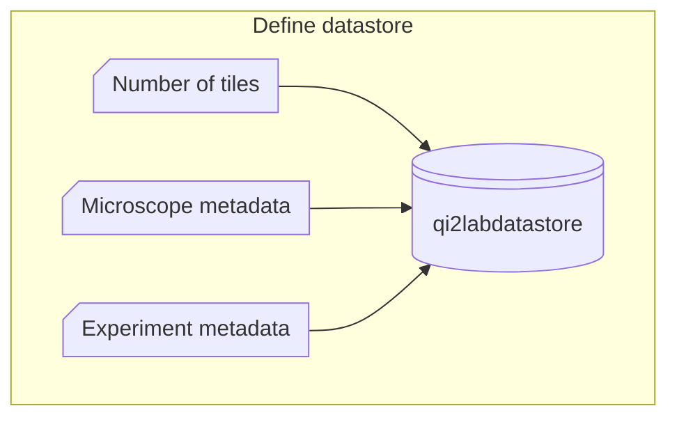
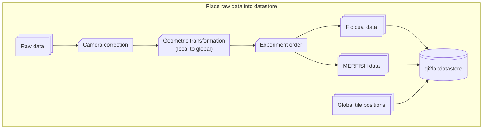
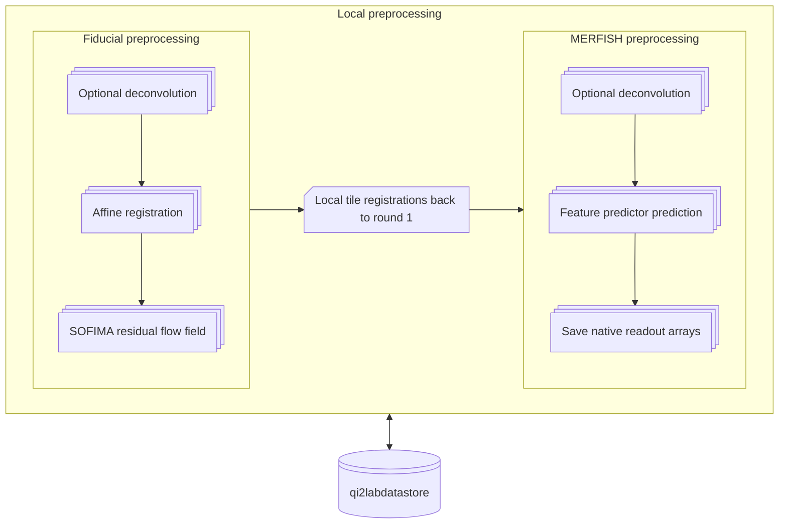
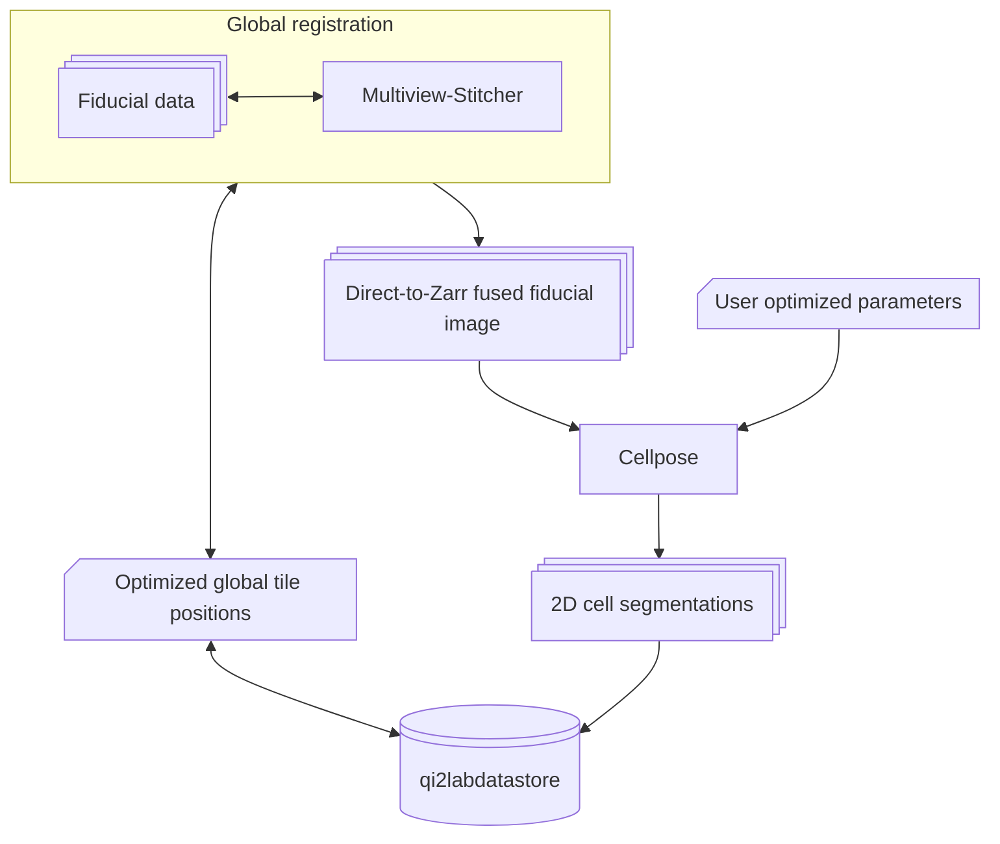
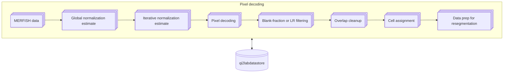
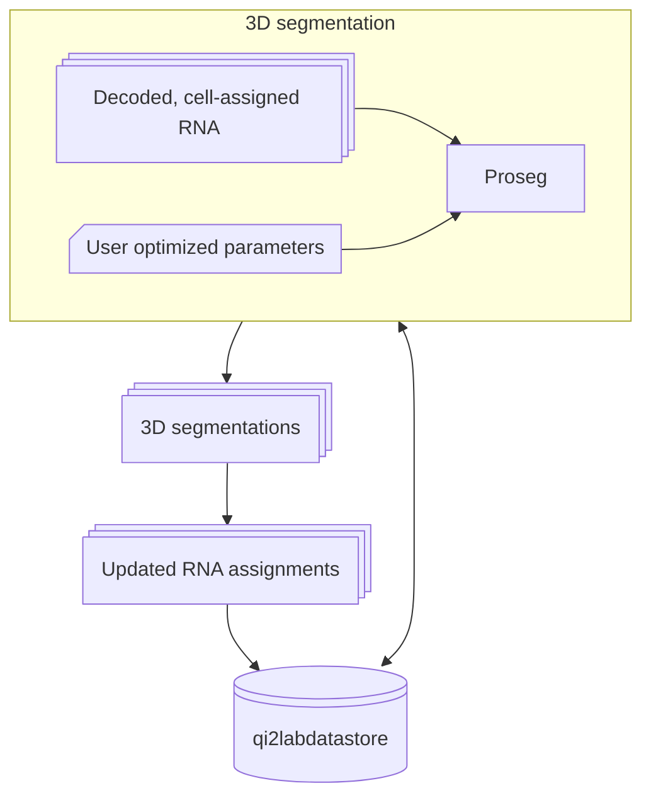

# Full Experiment Analysis Workflow

## Initialize datastore



## Populate datastore


##  Deconvolve, locally register, and spot predict all tiles



The qi2lab preprocessing CLI deconvolves fiducial and readout images by default.
Use `--no-decon` to disable readout deconvolution while retaining fiducial
deconvolution. Fiducial rounds are registered to round 1 using affine
registration and, when enabled, SOFIMA residual flow. The residual is saved only
when it improves alignment. Readout preprocessing saves corrected images,
optional deconvolved images, and feature predictions.

Decoding applies chromatic, affine, and SOFIMA transforms on each tile's round-1
grid. Transcript coordinates are then mapped to world coordinates using the
stage position, camera calibration, voxel spacing, and global registration.

## Global registration and fusion of first fiducial round



Global registration uses multiview-stitcher with the stored stage positions as
the starting geometry. Fiducial fusion preserves Z spacing and downsamples each
lateral axis by `round(z_spacing / lateral_spacing, 1)`. The maximum-Z
projection and Cellpose labels are stored in `fiducial_projection.ome.zarr`;
the fused grid is used to transform Cellpose ROIs into global coordinates.
Replacing the projection archives the previous segmentation; run Cellpose again
after fusion. Rerun the global stage with:

```bash
uv run qi2lab-preprocess /path/to/experiment --global-registration-only
```

## Fuse all channels

Once local and global registrations are complete, create one multichannel
OME-NGFF v0.6 image in `qi2labdatastore/fused.ome.zarr`:

```bash
uv run qi2lab-fuseall /path/to/experiment \
  --output-chunk-zyx 32,2048,2048 \
  --fusion-workers 30 \
  --compression blosc-lz4 \
  --compression-level 1
```

Channel 0 is the first-round fiducial; remaining channels are the codebook bits
in numeric order. Fusion applies local and global affine registration; chromatic
correction is applied during decoding, and SOFIMA fields are not used in fusion.
Add `--write-ome-tiffs` to export each channel under `qi2labdatastore/fused_tiff/`.

Fusion uses lossless Blosc-Zstd compression by default. The command also accepts
`blosc-lz4` and `zstd`, with compression levels from 1 to 9. Choose
`--output-chunk-zyx` and `--fusion-workers` for the available CPU and memory;
larger chunks require more memory per worker. Rerunning fusion creates a new
fused image revision and starts from the beginning.

## Pixel decoding




Optional chromatic affine estimation during iterative normalization uses decoded
RNA centroids and saves the calibration for subsequent decoding.

## Viewer inspection

Use `viewer` to inspect local and global images with transcript and cell boundary
overlays. Local warped views can display affine and SOFIMA registration.

## 3D segmentation based on decoded RNA


